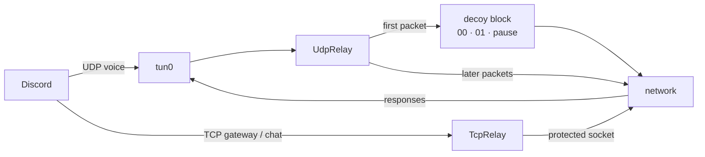

<div align="center">


# Vextro DRV

**Discord voice routing for Android — one app, one tunnel.**

Put Discord's voice traffic on a route that survives restrictive networks, without pushing the
whole phone through a VPN. Only `com.discord` is touched; every other app keeps its normal
connection, speed and battery life.

<br>

[](https://developer.android.com)
[](#requirements)
[](#download)
[](LICENSE)
[](#build)

[Download](#download) · [How it works](#how-it-works) · [Build](#build) · [العربية](#العربية)

</div>

---

## Overview

Vextro DRV is the Android companion to the Drover idea: instead of hiding traffic behind a
full-device VPN, it adapts the **first packet** of each voice stream so the connection is read
differently by the network, then lets the rest of the call flow untouched.

The result is a tunnel that costs almost nothing: two small markers and a 1.2 KB block per
voice stream, sent once, followed by a short pause.

| | Full-device VPN | Vextro DRV |
|---|---|---|
| Apps affected | all of them | Discord only |
| Data overhead | everything re-routed | ~1.2 KB per voice stream |
| Extra latency | continuous | once, at stream start |
| Battery | always on | negligible |
| Works with other apps | slows them down | they never notice |

## Features

- **Per-app tunnel** — `addAllowedApplication("com.discord")`, nothing else is routed.
- **Voice-first logic** — the first 74-byte UDP packet of a stream is preceded by the packaged
  1200-byte block, two marker bytes and a configurable pause.
- **Order preserved** — packets arriving during the pause are queued and sent afterwards in order.
- **TCP relay** — gateway, chat and login keep working because each TCP session is terminated
  locally and reconnected through a protected socket.
- **Return path rebuilt** — responses get fresh IPv4/UDP headers and checksums before going back
  into the tunnel.
- **Arabic & English** — switch instantly from the flags in the header.
- **Live view** — counters for handled packets, stream starts, returned packets and TCP sessions,
  plus an in-app log.

## How it works



1. A `VpnService` tunnel is created with a single allowed package.
2. Raw IPv4 packets are parsed by hand (no libraries): source, destination, ports, payload.
3. UDP streams are tracked by address and port tuple. The first packet that matches the size rule
   triggers the opening sequence; everything after it is forwarded as-is.
4. TCP segments are answered locally, so the app never notices that its connection is relayed.

## Requirements

- Android 7.0 (API 24) or newer.
- Discord installed under the package name `com.discord`.
- ARM, ARM64 or x86 — the app has no native code, so every ABI is supported.

## Download

Grab [`Vextro-DRV-v1.1.apk`](Vextro-DRV-v1.1.apk) from this repository, or install over ADB:

```bash
adb install -r Vextro-DRV-v1.1.apk
```

## Build

```bash
git clone https://github.com/sameh-ayoub/Vextro-drover.git
cd Vextro-drover

export ANDROID_HOME=/path/to/android-sdk
./gradlew assembleDebug
```

The APK is written to `app/build/outputs/apk/debug/`.

`compileSdk 34` · `targetSdk 33` · `minSdk 24` · Java 17 · no third-party dependencies.

## Usage

1. Open the app and press **Start**.
2. Accept the VPN request — only Discord is routed.
3. Join a voice channel; the counters move within a few seconds.
4. Press **Stop** to close the tunnel.

## Settings

| Setting | Default | What it does |
|---|---|---|
| **Delay** | `50 ms` | Pause between the opening markers and the original packet |
| **Strict mode** | on | Applies the opening sequence only to 74-byte packets |
| **Decoy packet** | on | Sends the packaged 1200-byte block before the markers |

Changes take effect after restarting the tunnel.

## Known limits

- Android allows one VPN at a time, so starting Vextro DRV disconnects any other VPN.
- IPv6 packets are skipped; networks that carry voice over IPv6 only are not covered.
- On Xiaomi/Redmi devices, enable Autostart and set the battery profile to *No restrictions*,
  otherwise the system may stop the service.

## Project layout

```
app/src/main/java/com/sameh/drover/
├── MainActivity.java       interface, language switch, counters
├── DroverVpnService.java   tunnel lifecycle and packet dispatch
├── UdpRelay.java           voice streams and the opening sequence
├── TcpRelay.java           local TCP termination
├── Net.java                IPv4 / UDP / TCP builders and checksums
└── Lang.java               in-app language handling
```

## Credits

Built and maintained by **[Sameh](https://github.com/sameh-ayoub)** — the Android implementation,
the interface and the packaging.

The technique and the packaged block come from the original
[Drover](https://github.com/hdrover/discord-drover) project by **hdrover**, which targets Discord
on Windows.

<div align="center">

**DEV BY SAMEH**

</div>

## License

[MIT](LICENSE) © 2026 Sameh

---

<div dir="rtl" align="right">

## العربية

**توجيه صوت ديسكورد على أندرويد — تطبيق واحد ونفق واحد.**

يضع Vextro DRV صوت ديسكورد على مسار يعمل في الشبكات المقيّدة، دون تمرير الجوال كله عبر VPN.
تطبيق ديسكورد وحده (`com.discord`) يدخل النفق، وبقية التطبيقات تبقى على اتصالها الطبيعي
بسرعتها واستهلاكها.

### الفكرة

بدل إخفاء الترافيك خلف VPN شامل، يُعدَّل **أول حزمة** من كل مسار صوتي، ثم يمر بقية المكالمة كما هو.
التكلفة: كتلة بحجم 1.2 كيلوبايت وبايتان للعلامة ووقفة قصيرة، مرة واحدة لكل مسار صوتي.

### المزايا

- نفق لتطبيق واحد: ديسكورد فقط.
- تمويه أول حزمة بحجم 74 بايت مع الحفاظ على ترتيب الحزم.
- وكيل TCP يُبقي البوابة والشات وتسجيل الدخول تعمل.
- عربي وإنجليزي، يُبدَّل من العلمين في الأعلى.
- عدّادات حية وسجل داخل التطبيق.

### التثبيت

```bash
adb install -r Vextro-DRV-v1.1.apk
```

### البناء

```bash
export ANDROID_HOME=/path/to/android-sdk
./gradlew assembleDebug
```

### الاستخدام

1. افتح التطبيق واضغط **تشغيل**.
2. اقبل طلب VPN — ديسكورد وحده يمر عبر النفق.
3. ادخل قناة صوتية وستتحرك العدّادات خلال ثوانٍ.
4. اضغط **إيقاف** لإغلاق النفق.

### الإعدادات

| الإعداد | الافتراضي | الوظيفة |
|---|---|---|
| **التأخير** | `50` مللي ثانية | الوقفة بين العلامات والحزمة الأصلية |
| **الوضع الدقيق** | مفعّل | تطبيق الإجراء على حزم 74 بايت فقط |
| **حزمة التمويه** | مفعّل | إرسال الكتلة المجهّزة قبل العلامات |

### حدود معروفة

- أندرويد يسمح بـ VPN واحد فقط، فتشغيل التطبيق يقطع أي VPN آخر.
- حزم IPv6 تُهمل، والشبكات التي تنقل الصوت عبر IPv6 فقط غير مشمولة.
- على أجهزة Xiaomi/Redmi فعّل «بدء تلقائي» واضبط البطارية على «بدون قيود».

<div align="center">

**صنع بواسطة سامح**

</div>

</div>
