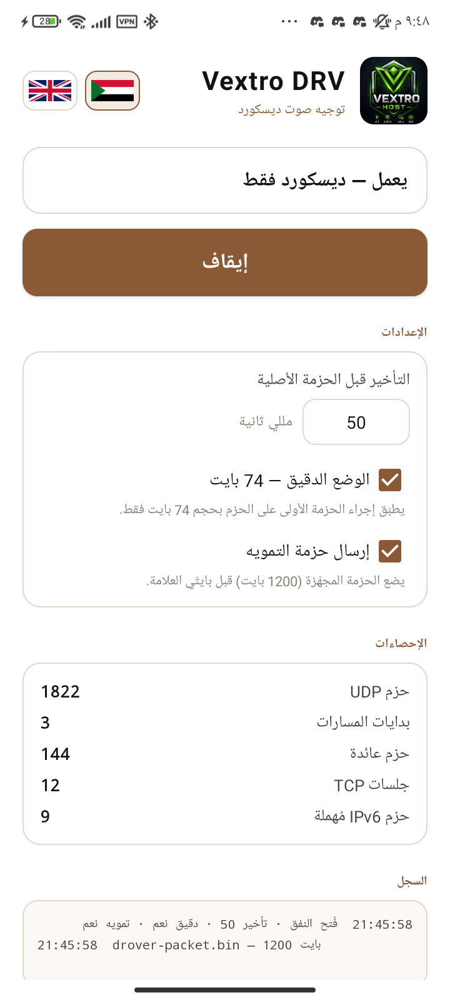
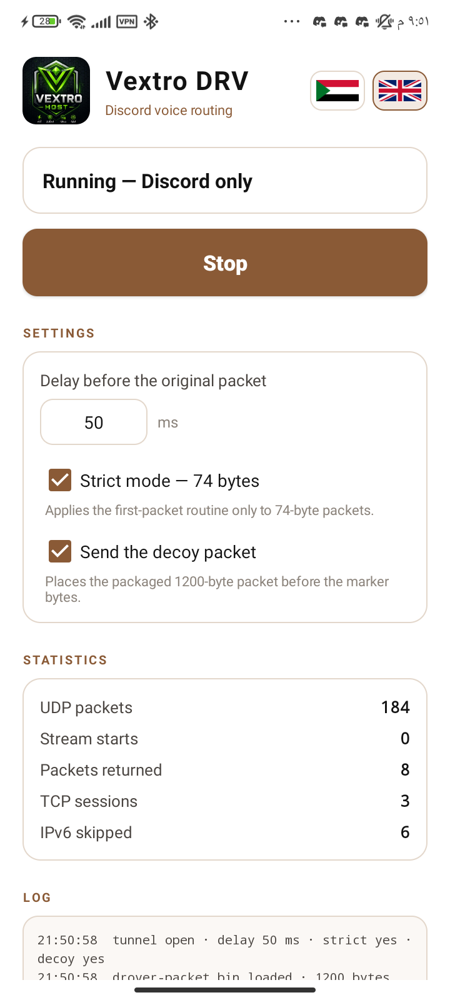
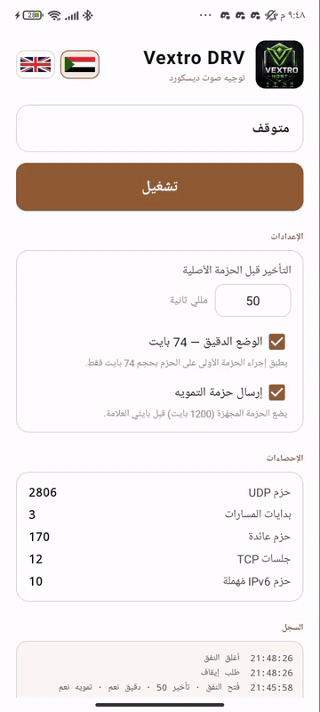
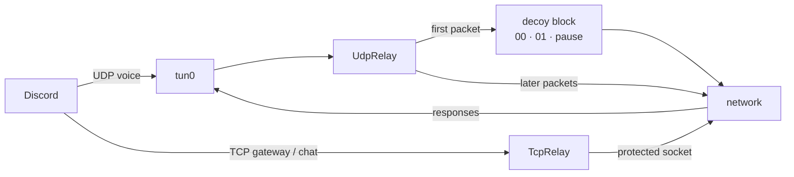

<div align="center">


# Vextro DRV

**Discord voice routing for Android — one app, one tunnel.**

<br>

<a href="https://github.com/sameh-ayoub/Vextro-DRV/releases/latest">
  
</a>

<br><br>

[](https://developer.android.com)
[](#requirements)
[](https://github.com/sameh-ayoub/Vextro-DRV/releases)
[](LICENSE)
[](#build)

[How it works](#how-it-works) · [FAQ](#faq) · [Install](#install) · [Build](#build) · [العربية](#العربية)

</div>

---

## Screenshots

<table>
<tr>
<td width="50%"></td>
<td width="50%"></td>
</tr>
<tr>
<td align="center"><sub>Arabic</sub></td>
<td align="center"><sub>English</sub></td>
</tr>
</table>

<div align="center">

<br>
<sub>Press start, join a call — counters move within seconds.</sub>
</div>

## Overview

Vextro DRV is the Android companion to the Drover idea: instead of hiding traffic behind a
full-device VPN, it adapts the **first packet** of each voice stream so the connection is read
differently by the network, then lets the rest of the call flow untouched.

Only `com.discord` enters the tunnel. Every other app keeps its normal connection, speed and
battery life.

| | Full-device VPN | Vextro DRV |
|---|---|---|
| Apps affected | all of them | Discord only |
| Data overhead | everything re-routed | ~1.2 KB per voice stream |
| Extra latency | continuous | once, at stream start |
| Battery | always on | negligible |
| Other apps | slowed down | never notice |

## Features

- **Per-app tunnel** — `addAllowedApplication("com.discord")`, nothing else is routed.
- **Voice-first logic** — the first 74-byte UDP packet of a stream is preceded by the packaged
  1200-byte block, two marker bytes and a configurable pause.
- **Order preserved** — packets arriving during the pause are queued and sent afterwards in order.
- **TCP relay** — gateway, chat and login keep working; each session is terminated locally and
  reconnected through a protected socket.
- **Return path rebuilt** — responses get fresh IPv4/UDP headers and checksums before going back
  into the tunnel.
- **Arabic & English** — switch instantly from the flags in the header.
- **Live counters** — handled packets, stream starts, returned packets, TCP sessions and IPv6 skips.

## How it works



1. A `VpnService` tunnel is created with a single allowed package.
2. Raw IPv4 packets are parsed by hand (no libraries): source, destination, ports, payload.
3. UDP streams are tracked by address and port tuple. The first packet that matches the size rule
   triggers the opening sequence; everything after it is forwarded as-is.
4. TCP segments are answered locally, so the app never notices that its connection is relayed.

## FAQ

**Is there a Drover for Android / for phones?**
The original [Drover](https://github.com/hdrover/discord-drover) is a Windows tool. Vextro DRV is an
independent Android implementation of the same idea — it runs on the phone itself, no computer needed.

**Discord text works but voice never connects on a restricted network. Is this for me?**
Yes. That is the exact case it addresses: the first packet of each voice stream is adapted so the
connection is not classified the same way, while text, chat and login keep working.

**Does it need a VPN subscription, root or an account?**
No. It uses the local `VpnService` API to route one package. No remote server, no account, no root.
Android allows one VPN at a time, so starting it disconnects any other VPN.

**Does it slow the rest of the phone?**
No. Only `com.discord` enters the tunnel; every other app leaves through the normal connection.

**Which Android versions are supported?**
Android 7.0 (API 24) and newer, on ARM, ARM64 and x86. Around 333 KB, no native code.
Tested on a Redmi 9A running Android 11.

**هل يوجد Drover للهاتف؟** نعم — هذا التطبيق. الفكرة الأصلية من Drover لـ ويندوز، وهذا تنفيذ مستقل لها على أندرويد.
**هل يحتاج روت أو VPN؟** لا روت. يستخدم `VpnService` محليًا لتوجيه ديسكورد وحده، بلا اشتراك وبلا سيرفر.
**هل يؤثر على بقية التطبيقات؟** لا، فقط `com.discord` يدخل النفق.

## Requirements

- Android 7.0 (API 24) or newer.
- Discord installed under the package name `com.discord`.
- ARM, ARM64 or x86 — no native code, so every ABI works.

## Install

Grab [`Vextro-DRV-v1.2.apk`](https://github.com/sameh-ayoub/Vextro-DRV/releases/latest) from the
releases page, or install over ADB:

```bash
adb install -r Vextro-DRV-v1.2.apk
```

The APK is signed with a private release key, so updates install cleanly over older versions
signed with the same key.

## Build

```bash
git clone https://github.com/sameh-ayoub/Vextro-DRV.git
cd Vextro-DRV

export ANDROID_HOME=/path/to/android-sdk
./gradlew assembleDebug     # or assembleRelease
```

The APK is written to `app/build/outputs/apk/`.

`compileSdk 34` · `targetSdk 33` · `minSdk 24` · Java 17 · no third-party dependencies.

Release builds read `keystore.properties` from the project root:

```properties
storeFile=release.jks
storePassword=********
keyAlias=vextro
keyPassword=********
```

Without that file the release build falls back to the debug key, so the repository stays buildable
for anyone who clones it.

## Usage

1. Open the app and press **Start**.
2. Accept the VPN request — only Discord is routed.
3. Join a voice channel; the counters move within a few seconds.
4. Press **Stop** to close the tunnel.

## Settings

| Setting | Default | What it does |
|---|---|---|
| **Delay** | `50 ms` | Pause between the opening markers and the original packet |
| **Strict mode** | on | Applies the opening sequence only to 74-byte packets |
| **Decoy packet** | on | Sends the packaged 1200-byte block before the markers |

Changes take effect after restarting the tunnel.

## Known limits

- Android allows one VPN at a time, so starting Vextro DRV disconnects any other VPN.
- IPv6 packets are skipped; networks that carry voice over IPv6 only are not covered.
- On Xiaomi/Redmi devices, enable Autostart and set the battery profile to *No restrictions*,
  otherwise the system may stop the service.
- Tested on a Redmi 9A running Android 11. Other devices are welcome in the issue tracker.

## Project layout

```
app/src/main/java/com/sameh/drover/
├── MainActivity.java       interface, language switch, counters
├── DroverVpnService.java   tunnel lifecycle and packet dispatch
├── UdpRelay.java           voice streams and the opening sequence
├── TcpRelay.java           local TCP termination
├── Net.java                IPv4 / UDP / TCP builders and checksums
└── Lang.java               in-app language handling
```

## Disclaimer

Personal use only, at your own risk. Routing traffic in a way that avoids a network policy may
conflict with your provider's terms or local regulations — that decision is yours.

## Credits

Built and maintained by **[Sameh](https://github.com/sameh-ayoub)** — the Android implementation,
the interface and the packaging.

The technique and the packaged block come from the original
[Drover](https://github.com/hdrover/discord-drover) project by **hdrover**, which targets Discord
on Windows.

<div align="center">

**DEV BY SAMEH**

</div>

## License

[MIT](LICENSE) © 2026 Sameh

---

<div dir="rtl" align="right">

## العربية

**توجيه صوت ديسكورد على أندرويد — تطبيق واحد ونفق واحد.**

يضع Vextro DRV صوت ديسكورد على مسار يعمل في الشبكات المقيّدة، دون تمرير الجوال كله عبر VPN.
تطبيق ديسكورد وحده (`com.discord`) يدخل النفق، وبقية التطبيقات تبقى على اتصالها الطبيعي
بسرعتها واستهلاكها.

### الفكرة

بدل إخفاء الترافيك خلف VPN شامل، يُعدَّل **أول حزمة** من كل مسار صوتي، ثم يمر بقية المكالمة كما هو.
التكلفة: كتلة بحجم 1.2 كيلوبايت وبايتان للعلامة ووقفة قصيرة، مرة واحدة لكل مسار صوتي.

### المزايا

- نفق لتطبيق واحد: ديسكورد فقط.
- تمويه أول حزمة بحجم 74 بايت مع الحفاظ على ترتيب الحزم.
- وكيل TCP يُبقي البوابة والشات وتسجيل الدخول تعمل.
- عربي وإنجليزي، يُبدَّل من العلمين في الأعلى.
- عدّادات حية وسجل داخل التطبيق.

### التثبيت

```bash
adb install -r Vextro-DRV-v1.2.apk
```

أو نزّل الملف من صفحة الإصدارات مباشرة.

### البناء

```bash
export ANDROID_HOME=/path/to/android-sdk
./gradlew assembleDebug
```

### الاستخدام

1. افتح التطبيق واضغط **تشغيل**.
2. اقبل طلب VPN — ديسكورد وحده يمر عبر النفق.
3. ادخل قناة صوتية وستتحرك العدّادات خلال ثوانٍ.
4. اضغط **إيقاف** لإغلاق النفق.

### الإعدادات

| الإعداد | الافتراضي | الوظيفة |
|---|---|---|
| **التأخير** | `50` مللي ثانية | الوقفة بين العلامات والحزمة الأصلية |
| **الوضع الدقيق** | مفعّل | تطبيق الإجراء على حزم 74 بايت فقط |
| **حزمة التمويه** | مفعّل | إرسال الكتلة المجهّزة قبل العلامات |

### حدود معروفة

- أندرويد يسمح بـ VPN واحد فقط، فتشغيل التطبيق يقطع أي VPN آخر.
- حزم IPv6 تُهمل، والشبكات التي تنقل الصوت عبر IPv6 فقط غير مشمولة.
- على أجهزة Xiaomi/Redmi فعّل «بدء تلقائي» واضبط البطارية على «بدون قيود».

### إخلاء مسؤولية

الاستخدام شخصي وعلى مسؤولية المستخدم. تعديل مسار الترافيك لتجاوز سياسة شبكة قد يخالف شروط
مزوّد الخدمة أو أنظمة بلدك، والقرار قرارك.

<div align="center">

**صنع بواسطة سامح**

</div>

</div>
